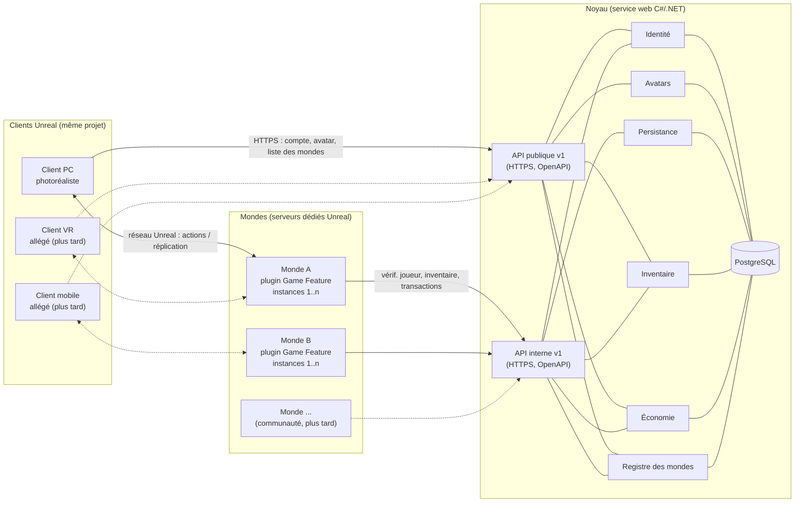
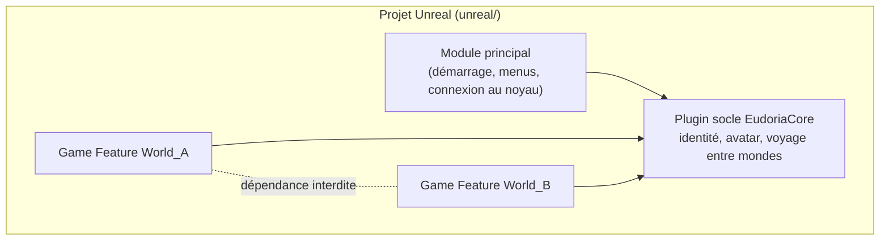

# EUDORIA — Architecture globale

> Statut : **révision 3 (étape 1.1, 2026-11-24)**. Vue d'ensemble, plus l'état réel du code en section 8.
> Les choix de technologies sont traités dans `docs/decisions/` (ADR 0001 à 0006 au statut « Accepté »).
> Hypothèses actuelles : client et serveurs de monde sous **Unreal Engine 5** (ADR-0003, ADR-0004),
> noyau en **C#/.NET** (ADR-0001), base **PostgreSQL** (ADR-0002).

## 1. Principes directeurs

1. **Noyau séparé des mondes.** Le noyau gère ce qui est commun à tout l'univers ; les mondes gèrent leur propre simulation.
2. **Le serveur fait autorité.** Le client affiche et envoie des *intentions* (« je veux avancer », « je veux acheter »). Le serveur décide. Le client n'est jamais cru sur parole.
3. **Contrats versionnés.** Tout échange entre composants passe par un contrat versionné : API du noyau en OpenAPI (`v1`, `v2`…), compatibilité réseau vérifiée entre client et serveur de monde.
4. **Une seule identité.** Un compte = un identifiant stable, un avatar, valable dans tous les mondes.
5. **Isolation.** Un monde qui plante, est mis à jour ou est malveillant ne doit pas compromettre le noyau ni les autres mondes.
6. **Multi-plateforme dès la conception.** La logique de jeu ne dépend jamais du type d'appareil ; seules les entrées, l'interface et le niveau de qualité visuelle changent entre PC, VR et mobile.
7. **Croissance progressive.** On démarre simple (peu de services, tout en local), mais les frontières sont tracées dès maintenant.

## 2. Les trois grands blocs

### 2.1 Le noyau (backend central)
Ensemble de services qui détiennent la **vérité commune** de l'univers :

| Service | Responsabilité |
|---|---|
| **Identité** | Comptes, authentification, émission et vérification des jetons. |
| **Avatars** | Apparence et identité visuelle de chaque habitant (paramètres d'apparence, pas les fichiers 3D eux-mêmes). |
| **Persistance** | Données durables des joueurs (état, progression, réputation). |
| **Inventaire** | Objets possédés, transferts entre joueurs et entre mondes. |
| **Économie** | Monnaie commune, transactions, journal d'audit. |
| **Registre des mondes** | Liste des mondes, adresses des serveurs, versions, orientation des joueurs vers une instance. |
| **Social** (plus tard) | Amis, groupes, messagerie, présence. |

Au début, ces services vivent dans **un seul programme découpé en modules** (« monolithe modulaire »).
Ils pourront devenir des programmes séparés si la charge l'exige, sans changer leurs contrats.
Le noyau s'appuie sur une **base de données principale** (ADR-0002) et, plus tard, sur un cache et un
système de messages.

Le noyau n'utilise **pas** Unreal : c'est un service web classique, indépendant du moteur.

### 2.2 Les mondes (serveurs dédiés Unreal)
- Chaque monde est un **plugin « Game Feature »** du projet Unreal, qui ne dépend que du **plugin socle** `EudoriaCore` (jamais d'un autre monde).
- Chaque monde tourne sur un ou plusieurs **serveurs dédiés** Unreal (instances), qui **simulent** le monde et en font autorité (réplication native d'Unreal, ADR-0004).
- Un serveur de monde ne gère **pas** l'identité, la monnaie ni l'inventaire commun : il les **demande au noyau** via l'API interne.
- Il peut avoir ses propres données locales (état d'une partie), à condition qu'elles ne contredisent pas le noyau.
- Contrainte Unreal : client et serveurs doivent être construits avec la même version du moteur et du socle (voir ADR-0004).

### 2.3 Les clients (Unreal)
- **Client PC** (premier prototype, rendu photoréaliste), puis **VR** et **mobile** (rendus allégés).
- Un même projet Unreal produit tous les clients ; la différence se fait par **profils de qualité** par plateforme (Device Profiles, Scalability) et par une couche d'entrées et d'interface propre à chaque plateforme (ADR-0003).
- Un client ne contient **aucune logique qui fait foi** : il affiche, prédit pour la fluidité, et envoie des intentions.
- Toute la logique est en **C++** ; les Blueprints ne servent qu'à assigner assets et réglages (ADR-0003).

## 3. Comment les blocs communiquent

| Liaison | Nature | Usage |
|---|---|---|
| Client → Noyau | **HTTPS**, API publique versionnée (contrat OpenAPI) | Connexion, profil, avatar, inventaire, liste des mondes, achats. |
| Client ↔ Monde | **Réseau Unreal** (UDP, réplication + appels au serveur) | Déplacements, actions, état du monde, discussion locale. |
| Monde → Noyau | **HTTPS**, API interne versionnée (contrat OpenAPI), authentifiée par serveur | Vérifier un joueur, lire/écrire l'inventaire, transactions, rapport d'état au registre. |
| Noyau → Monde | Notifications (plus tard, via système de messages) | Ex. : un objet a été donné au joueur depuis un autre monde. |

### Parcours type d'un joueur
1. Le client se connecte au **noyau** (Identité) et reçoit un **jeton**.
2. Il demande au **registre des mondes** où aller ; le registre renvoie l'adresse d'un serveur de monde compatible avec la version du client.
3. Le client se connecte au **serveur dédié** du monde en présentant son jeton.
4. Le serveur de monde **vérifie le jeton** (signature ou appel au noyau) et charge l'avatar depuis le noyau.
5. Pendant la session, le monde envoie au noyau tout ce qui doit être persisté ou qui touche l'économie.
6. Pour changer de monde (portail), le client redemande une destination au registre et recommence à l'étape 3.

## 4. Schéma d'ensemble



Les flèches en pointillés représentent ce qui viendra plus tard.

### Organisation interne du projet Unreal



## 5. Sécurité (vue d'ensemble)
- Tout le trafic externe vers le noyau est chiffré (HTTPS).
- Les jetons d'identité sont signés et expirent ; le noyau peut les révoquer.
- Les serveurs de monde ont leur **propre identité** auprès du noyau, avec des droits limités (un monde ne peut pas créer de monnaie à volonté).
- Les appels des clients aux serveurs de monde sont **validés côté serveur** (aucune confiance dans les valeurs envoyées).
- Les opérations économiques sont atomiques et journalisées.
- Les secrets ne sont jamais dans le code (variables d'environnement).

## 6. Structure du dépôt (validée le 2026-11-24)

Un seul dépôt git (« monorepo ») :

```
eudoria/
├── docs/                    # vision, roadmap, architecture, ADR, progrès, installation
├── core/                    # le noyau (service web C#/.NET)
├── shared/
│   └── api/                 # contrats OpenAPI du noyau (public + interne), en YAML
├── unreal/                  # le projet Unreal (client + serveurs de monde)
│   ├── Source/              # code C++ du module principal
│   ├── Plugins/
│   │   ├── EudoriaCore/     # plugin socle (C++)
│   │   └── GameFeatures/    # un plugin par monde (World_<Nom>)
│   ├── Config/              # réglages en texte (.ini), profils de qualité par plateforme
│   ├── Content/             # assets binaires (Git LFS, ADR-0005)
│   └── Scripts/             # scripts Python d'automatisation de l'éditeur
└── tools/                   # scripts de dev, environnement local (Docker Compose…)
```

Le détail interne de chaque dossier sera défini à l'étape qui le crée.

## 7. Ce qui n'est pas encore décidé
- Hébergement des serveurs (Linux), déploiement, observabilité → avant toute mise en ligne publique.
- Mécanisme de distribution du contenu des mondes (paquets par monde) → étape 6.

## 8. Le noyau aujourd'hui (étape 1.1)

```
global.json                      # SDK .NET 11 épinglé ; lanceur de tests Microsoft.Testing.Platform
.editorconfig                    # style de code (lu par Visual Studio et `dotnet format`)
.env.example                     # modèle des réglages locaux (.env, jamais commité)
shared/api/core-v1.yaml          # contrat OpenAPI public v1 — écrit AVANT le code
tools/dev/
├── docker-compose.yml           # PostgreSQL 18.7, publié sur 127.0.0.1 uniquement
├── DotEnv.ps1                   # lecture de .env (partagée par les deux scripts)
├── start-db.ps1                 # démarre / arrête la base (-Stop)
└── run-core.ps1                 # lance le noyau, chaîne de connexion construite en mémoire
core/
├── Eudoria.Core.slnx            # solution
├── Directory.Build.props        # net10.0, avertissements = erreurs, analyse figée sur .NET 10
├── Directory.Packages.props     # TOUTES les versions de paquets, au même endroit
├── src/Eudoria.Core.Api/        # hôte ASP.NET Core (Minimal APIs)
│   ├── Program.cs               # démarrage ; routes publiques sous /v1
│   ├── Database/                # options + source de données PostgreSQL (Npgsql)
│   └── Health/                  # /v1/health/live et /v1/health/ready
└── tests/Eudoria.Core.Api.Tests/
    ├── HealthEndpointsTests.cs  # comportement des routes
    ├── ContractTests.cs         # le noyau respecte core-v1.yaml, dans les deux sens
    └── Infrastructure/          # noyau en mémoire, PostgreSQL jetable (Testcontainers), validateur de schéma
```

- **Exécution :** le programme cible `net10.0` et tourne sur le runtime **.NET 10 LTS** (ADR-0001) ; le SDK 11
  ne sert qu'à compiler.
- **Monolithe modulaire :** un seul projet hôte pour l'instant. Chaque service du noyau deviendra un projet
  séparé (`Eudoria.Core.Identity` à l'étape 1.2) que l'hôte assemble.
- **Configuration :** la chaîne de connexion vient de `ConnectionStrings:Core` (variable d'environnement
  `ConnectionStrings__Core`). Sans elle, le noyau **refuse de démarrer**.
- **Santé :** `live` ne touche à rien (le processus répond) ; `ready` exécute `SELECT 1` sur PostgreSQL avec
  un délai maximum de 2 s et répond 503 sinon. Aucune réponse ne contient de détail interne : les causes
  sont dans les journaux du serveur seulement.
- **Tests :** xUnit v3 ; base PostgreSQL réelle et jetable créée dans Docker à chaque série de tests.
