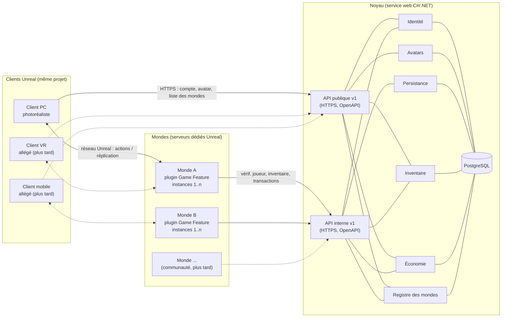
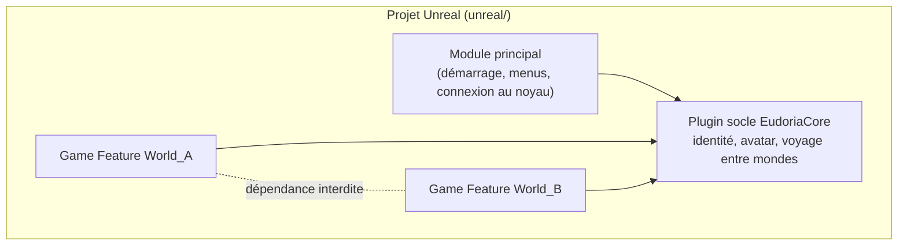

# EUDORIA — Architecture globale

> Statut : **révision 5 (étape 1.6 A, 2026-11-26)**. Vue d'ensemble, plus l'état réel du code en sections 8 et 9.
> Les choix de technologies sont traités dans `docs/decisions/` (ADR 0001 à 0007 au statut « Accepté »).
> Hypothèses actuelles : client et serveurs de monde sous **Unreal Engine 5** (ADR-0003, ADR-0004),
> noyau en **C#/.NET** (ADR-0001), base **PostgreSQL** (ADR-0002).

## 1. Principes directeurs

1. **Noyau séparé des mondes.** Le noyau gère ce qui est commun à tout l'univers ; les mondes gèrent leur propre simulation.
2. **Le serveur fait autorité.** Le client affiche et envoie des *intentions* (« je veux avancer », « je veux acheter »). Le serveur décide. Le client n'est jamais cru sur parole.
3. **Contrats versionnés.** Tout échange entre composants passe par un contrat versionné : API du noyau en OpenAPI (`v1`, `v2`…), compatibilité réseau vérifiée entre client et serveur de monde.
4. **Une seule identité.** Un compte = un identifiant stable, un avatar, valable dans tous les mondes.
5. **Isolation.** Un monde qui plante, est mis à jour ou est malveillant ne doit pas compromettre le noyau ni les autres mondes.
6. **Multi-plateforme dès la conception.** La logique de jeu ne dépend jamais du type d'appareil ; seules les entrées, l'interface et le niveau de qualité visuelle changent entre PC, VR et mobile.
7. **Croissance progressive.** On démarre simple (peu de services, tout en local), mais les frontières sont tracées dès maintenant.

## 2. Les trois grands blocs

### 2.1 Le noyau (backend central)
Ensemble de services qui détiennent la **vérité commune** de l'univers :

| Service | Responsabilité |
|---|---|
| **Identité** | Comptes, authentification, émission et vérification des jetons. |
| **Avatars** | Apparence et identité visuelle de chaque habitant (paramètres d'apparence, pas les fichiers 3D eux-mêmes). |
| **Persistance** | Données durables des joueurs (état, progression, réputation). |
| **Inventaire** | Objets possédés, transferts entre joueurs et entre mondes. |
| **Économie** | Monnaie commune, transactions, journal d'audit. |
| **Registre des mondes** | Liste des mondes, adresses des serveurs, versions, orientation des joueurs vers une instance. |
| **Social** (plus tard) | Amis, groupes, messagerie, présence. |

Au début, ces services vivent dans **un seul programme découpé en modules** (« monolithe modulaire »).
Ils pourront devenir des programmes séparés si la charge l'exige, sans changer leurs contrats.
Le noyau s'appuie sur une **base de données principale** (ADR-0002) et, plus tard, sur un cache et un
système de messages.

Le noyau n'utilise **pas** Unreal : c'est un service web classique, indépendant du moteur.

### 2.2 Les mondes (serveurs dédiés Unreal)
- Chaque monde est un **plugin « Game Feature »** du projet Unreal, qui ne dépend que du **plugin socle** `EudoriaCore` (jamais d'un autre monde).
- Chaque monde tourne sur un ou plusieurs **serveurs dédiés** Unreal (instances), qui **simulent** le monde et en font autorité (réplication native d'Unreal, ADR-0004).
- Un serveur de monde ne gère **pas** l'identité, la monnaie ni l'inventaire commun : il les **demande au noyau** via l'API interne.
- Il peut avoir ses propres données locales (état d'une partie), à condition qu'elles ne contredisent pas le noyau.
- Contrainte Unreal : client et serveurs doivent être construits avec la même version du moteur et du socle (voir ADR-0004).

### 2.3 Les clients (Unreal)
- **Client PC** (premier prototype, rendu photoréaliste), puis **VR** et **mobile** (rendus allégés).
- Un même projet Unreal produit tous les clients ; la différence se fait par **profils de qualité** par plateforme (Device Profiles, Scalability) et par une couche d'entrées et d'interface propre à chaque plateforme (ADR-0003).
- Un client ne contient **aucune logique qui fait foi** : il affiche, prédit pour la fluidité, et envoie des intentions.
- Toute la logique est en **C++** ; les Blueprints ne servent qu'à assigner assets et réglages (ADR-0003).

## 3. Comment les blocs communiquent

| Liaison | Nature | Usage |
|---|---|---|
| Client → Noyau | **HTTPS**, API publique versionnée (contrat OpenAPI) | Connexion, profil, avatar, inventaire, liste des mondes, achats. |
| Client ↔ Monde | **Réseau Unreal** (UDP, réplication + appels au serveur) | Déplacements, actions, état du monde, discussion locale. |
| Monde → Noyau | **HTTPS**, API interne versionnée (contrat OpenAPI), authentifiée par serveur | Lire le profil et l'avatar d'un joueur (déjà identifié par son ticket d'entrée, sans appel au noyau — ADR-0007), lire/écrire l'inventaire, transactions, rapport d'état au registre. |
| Noyau → Monde | Notifications (plus tard, via système de messages) | Ex. : un objet a été donné au joueur depuis un autre monde. |

### Parcours type d'un joueur
1. Le client se connecte au **noyau** (Identité) et reçoit un **jeton**.
2. Il demande au **registre des mondes** où aller ; le registre renvoie l'adresse d'un serveur de monde compatible avec la version du client.
3. Il demande au noyau un **ticket d'entrée** pour ce monde (60 s, usage unique), puis se connecte au **serveur
   dédié** du monde en le présentant. Le jeton d'accès, lui, ne quitte jamais la liaison client ↔ noyau.
4. Le serveur de monde **vérifie le ticket seul, par sa signature** (clés publiques du noyau en cache), sans appeler
   le noyau (ADR-0007), puis charge l'avatar depuis le noyau.
5. Pendant la session, le monde envoie au noyau tout ce qui doit être persisté ou qui touche l'économie.
6. Pour changer de monde (portail), le client redemande une destination au registre et recommence à l'étape 3.

## 4. Schéma d'ensemble



Les flèches en pointillés représentent ce qui viendra plus tard.

### Organisation interne du projet Unreal



## 5. Sécurité (vue d'ensemble)
- Tout le trafic externe vers le noyau est chiffré (HTTPS).
- Les jetons d'identité sont signés et expirent ; le noyau peut les révoquer.
- Les serveurs de monde ont leur **propre identité** auprès du noyau, avec des droits limités (un monde ne peut pas créer de monnaie à volonté).
- Les appels des clients aux serveurs de monde sont **validés côté serveur** (aucune confiance dans les valeurs envoyées).
- Les opérations économiques sont atomiques et journalisées.
- Les secrets ne sont jamais dans le code (variables d'environnement).

## 6. Structure du dépôt (validée le 2026-11-24)

Un seul dépôt git (« monorepo ») :

```
eudoria/
├── docs/                    # vision, roadmap, architecture, ADR, progrès, installation
├── core/                    # le noyau (service web C#/.NET)
├── shared/
│   └── api/                 # contrats OpenAPI du noyau (public + interne), en YAML
├── unreal/                  # le projet Unreal (client + serveurs de monde)
│   ├── Source/              # code C++ du module principal
│   ├── Plugins/
│   │   ├── EudoriaCore/     # plugin socle (C++)
│   │   └── GameFeatures/    # un plugin par monde (World_<Nom>)
│   ├── Config/              # réglages en texte (.ini), profils de qualité par plateforme
│   ├── Content/             # assets binaires (Git LFS, ADR-0005)
│   └── Scripts/             # scripts Python d'automatisation de l'éditeur
└── tools/                   # scripts de dev, environnement local (Docker Compose…)
```

Le détail interne de chaque dossier sera défini à l'étape qui le crée.

## 7. Ce qui n'est pas encore décidé
- Hébergement des serveurs (Linux), déploiement, observabilité → avant toute mise en ligne publique.
- Mécanisme de distribution du contenu des mondes (paquets par monde) → étape 6.

## 8. Le noyau aujourd'hui (étape 1.6 A)

```
global.json                      # SDK .NET 11 épinglé ; lanceur de tests Microsoft.Testing.Platform
.editorconfig                    # style de code (lu par Visual Studio et `dotnet format`) ; migrations = code généré
.config/dotnet-tools.json        # outil local dotnet-ef (version épinglée)
.env.example                     # modèle des réglages locaux (.env, jamais commité)
shared/api/core-v1.yaml          # contrat OpenAPI public v1 (1.4.0) — écrit AVANT le code
shared/test-vectors/entry-tickets/ # tickets signés + clés PUBLIQUES + verdict attendu : même verdict exigé de chaque vérificateur
tools/dev/
├── docker-compose.yml           # PostgreSQL 18.7, publié sur 127.0.0.1 uniquement
├── DotEnv.ps1                   # lecture de .env + chaîne de connexion et deux clés de signature en mémoire (partagés)
├── new-signing-key.ps1          # génère dans .env la clé ES256 des jetons d'accès, ou celle des tickets (-EntryTickets)
├── build-password-blocklist.ps1 # fabrique la liste des mots de passe courants à partir de listes publiques (SecLists)
├── NewSigningKey.cs             # petit programme C# « fichier unique » appelé par le script ci-dessus
├── new-entry-ticket-vectors.ps1 # régénère les jeux d'essai des tickets (clés jetables en mémoire)
├── NewEntryTicketVectors.cs     # petit programme C# « fichier unique » appelé par le script ci-dessus
├── start-db.ps1                 # démarre / arrête la base (-Stop)
├── migrate.ps1                  # applique les migrations de chaque module (geste volontaire, jamais au démarrage)
└── run-core.ps1                 # lance le noyau, chaîne de connexion et clé passées en mémoire
core/
├── Eudoria.Core.slnx            # solution
├── Directory.Build.props        # net10.0, avertissements = erreurs, analyse figée sur .NET 10
├── Directory.Packages.props     # TOUTES les versions de paquets, au même endroit
├── src/Eudoria.Core.Api/        # hôte ASP.NET Core (Minimal APIs)
│   ├── Program.cs               # démarrage ; assemble les modules ; limiteur de débit ; authentification ; routes /v1
│   ├── appsettings.json         # réglages non secrets (durées des jetons, émetteur, audience, limites)
│   ├── Database/                # options + source de données PostgreSQL (Npgsql), partagée par les modules
│   └── Health/                  # /v1/health/live et /v1/health/ready
├── src/Eudoria.Core.Identity/   # module Identité (comptes, sessions, jetons) — seule partie publique : IdentityModule
│   ├── IdentityModule.cs        # AddIdentityModule() / MapIdentityEndpoints() ; vérification stricte des jetons Bearer
│   ├── Accounts/                # entité Account ; règles et normalisation (e-mail, pseudo, mot de passe NFKC) ; codes d'erreur
│   ├── Passwords/               # IPasswordHasher ; Argon2id via NSec (libsodium), format PHC ; détection « à ré-hacher » ;
│   │                            # liste des mots de passe courants (ressource embarquée) ; limite de hachages simultanés
│   ├── Throttling/              # compteurs d'échecs (LoginThrottle), clé client (IPv4 / IPv6 /64), politiques de débit
│   ├── Http/                    # lecture stricte des corps JSON ; réponses d'erreur Problem Details (400, 401, 409, 429, 503)
│   ├── Registration/            # POST /v1/accounts : service d'inscription
│   ├── Tokens/                  # options, clé ES256 (kid), types explicites, émission des JWT, jeton de renouvellement ;
│   │                            # refus des jetons révoqués
│   ├── EntryTickets/            # tickets d'entrée des mondes : options, mondes connus (IKnownWorlds), clé distincte,
│   │                            # émission, POST /v1/worlds/{worldId}/entry-tickets, GET /v1/entry-tickets/keys (JWKS)
│   ├── Sessions/                # POST /v1/auth/login, /refresh, /logout : connexion, rotation, révocation, « tout déconnecter »
│   ├── Profile/                 # GET /v1/me (route protégée)
│   ├── AccountSecurity/         # POST /v1/me/password, POST /v1/me/sessions/revoke-all (routes protégées)
│   └── Persistence/             # EF Core : IdentityDbContext (schéma « identity »), configurations, Migrations/
└── tests/
    ├── Eudoria.Core.Identity.Tests/  # unitaires : règles, NFKC, Argon2id, clé, JWT, jeton de renouvellement, liste de mots
    │                                 # de passe courants, compteurs d'échecs (horloge manuelle), clé client IPv6 /64
    ├── Eudoria.ThirdParty.WorldVerifier/       # TIERS SIMULÉ : vérifie un ticket comme le fera un serveur de monde,
    │                                           # sans aucun lien avec le code du noyau ni librairie JWT (référence du C++)
    ├── Eudoria.ThirdParty.WorldVerifier.Tests/ # ses règles une à une (horloge manuelle, faux serveur de clés) + jeux d'essai
    └── Eudoria.Core.Api.Tests/
        ├── HealthEndpointsTests.cs   # comportement des routes santé
        ├── RegistrationTests.cs      # inscription de bout en bout, concurrence, journaux, migrations à jour
        ├── SessionTests.cs           # connexion, /me, jetons falsifiés, rotation, vol, expirations, déconnexion, concurrence
        ├── ThrottlingTests.cs        # blocages, e-mail inconnu, débit par adresse (IPv6 /64), 50 essais simultanés, 503
        ├── AccountSecurityTests.cs   # changement de mot de passe, « tout déconnecter », course avec un renouvellement
        ├── EntryTicketTests.cs       # tickets : émission, refus, clés publiées, séparation des jetons, et le tiers
        │                             # qui vérifie un vrai ticket (même UUID que /me)
        ├── ContractTests.cs          # le noyau respecte core-v1.yaml, dans les deux sens
        ├── SchemaValidatorTests.cs   # le validateur maison rejette bien ce qu'il prétend vérifier
        └── Infrastructure/           # noyau en mémoire (clé jetable, réglages et adresse client par test), PostgreSQL
                                      # jetable migrée, capture des journaux, compteur de hachages, commit mis en pause
```

- **Exécution :** le programme cible `net10.0` et tourne sur le runtime **.NET 10 LTS** (ADR-0001) ; le SDK 11
  ne sert qu'à compiler.
- **Monolithe modulaire :** l'hôte `Eudoria.Core.Api` assemble les modules ; chaque module est un projet séparé dont
  tout est `internal` sauf sa classe d'entrée (`IdentityModule`). Chaque module possède **son schéma PostgreSQL** et
  **ses migrations** (historique dans `<schéma>.__ef_migrations_history`) ; aucun module ne lit les tables d'un autre.
  Tous partagent une seule source de connexions (`NpgsqlDataSource`) enregistrée par l'hôte.
- **Comptes (`identity.accounts`) :** `id` UUID v7 (identifiant stable, le seul que les autres systèmes stockeront),
  `email` normalisé unique, `pseudo` tel que saisi + `pseudo_normalized` unique (casse ignorée), `password_hash`
  Argon2id au format PHC (paramètres inclus, durcissables plus tard), `created_at`, `tokens_valid_after` (voir
  « Tout déconnecter »). Unicité garantie par la base.
- **Inscription :** `POST /v1/accounts` → 202 (créé, **ou** e-mail déjà utilisé : indiscernable exprès), 400 / 409 en
  Problem Details (RFC 9457) avec un code machine par erreur. Mot de passe normalisé NFKC avant contrôle et hachage.
  Les deux cas « 202 » exécutent **exactement les mêmes requêtes** : contrôle du pseudo, hachage, une seule requête
  `INSERT … ON CONFLICT DO NOTHING` (l'unicité est vérifiée par la base, sans exception, donc sans erreur dans les
  journaux), puis contrôle du pseudo de nouveau (il distingue une course perdue sur le pseudo → 409).
  Ni l'e-mail ni le mot de passe ne sont journalisés.
- **Mots de passe courants :** refusés à l'inscription et au changement (`password_too_common`) : liste embarquée de
  29 961 mots de passe issus de fuites (SecLists, licence MIT ; ≥ 12 caractères, NFKC, minuscules ; source et empreintes
  dans `Passwords/common-passwords.SOURCES.md`), plus les mots du contexte (pseudo, partie de l'e-mail avant `@`,
  « eudoria », à partir de 4 caractères). Pas vérifié à la connexion.
- **Sessions (`identity.refresh_tokens`) :** une ligne par jeton de renouvellement : `id`, `account_id` (clé étrangère,
  suppression en cascade), `family_id` (= une session, toutes les rotations d'une connexion), `token_hash` (**SHA-256**
  unique : la valeur du jeton n'est jamais stockée), `created_at`, `expires_at` (7 jours), `session_expires_at`
  (30 jours après la connexion), `revoked_at`.
- **Connexion :** `POST /v1/auth/login` → 200 avec une paire de jetons (`Cache-Control: no-store`), ou 401
  `invalid_credentials` identique pour un e-mail inconnu et un mauvais mot de passe (vérification contre une empreinte
  factice dans le premier cas, même durée). Une empreinte à un ancien coût Argon2id est **ré-hachée** au coût actuel.
  La session n'est ouverte que si l'empreinte vérifiée est toujours celle du compte (ligne du compte verrouillée) :
  un changement de mot de passe simultané ne laisse pas passer l'ancien mot de passe.
- **Limitation des tentatives :** (1) échecs de connexion comptés par **e-mail + adresse du client** (5 gratuits, puis
  blocage 1, 2, 4, 8, 15 min ; remis à zéro par un succès, oubliés après 24 h) et par **e-mail seul** (20 en 15 min →
  15 min), que le compte existe ou non ; pendant un blocage, **le mot de passe n'est pas vérifié** (429
  `too_many_attempts` + `Retry-After`, identique pour un e-mail inconnu). Les essais en cours comptent d'avance (50 essais
  simultanés → au plus 5 vérifiés). Compteurs **en mémoire**, bornés (100 000 clés), clés = HMAC-SHA-256 avec un secret
  tiré au démarrage (aucun e-mail ni adresse en clair) ; remis à zéro si le noyau redémarre. (2) **Débit par adresse**
  (limiteur intégré d'ASP.NET Core, fenêtre glissante) : connexion 30/min, inscription 10/h, renouvellement 60/min,
  changement de mot de passe et « tout déconnecter » 30/min. Adresse = IPv4, ou **préfixe /64** en IPv6 (un particulier
  dispose souvent d'un bloc /64 entier). (3) Au plus **4 hachages Argon2id simultanés** ; au-delà de 10 s d'attente,
  503 `server_busy`. Tous les seuils sont dans `appsettings.json` (`Identity:Throttling`).
- **Jeton d'accès :** JWT signé **ES256** (ECDSA P-256), 15 min, en-tête `alg`/`kid`/`typ` (`typ` =
  **`eudoria-access+jwt`** depuis la 1.6), revendications `sub` (UUID du compte), `iss` et `aud` = `eudoria-core`,
  `iat`, `exp`, `jti` — rien d'autre. Vérifié sans base de données : ES256 seul, **type `eudoria-access+jwt` seul**
  (le type générique `JWT` et le type des tickets sont refusés), notre clé, notre émetteur, audience `eudoria-core`
  seule, signature et expiration obligatoires, 30 s de tolérance d'horloge, revendications gardées telles quelles
  (`MapInboundClaims = false`). **Il n'est accepté que par le noyau** et n'est jamais remis à un monde.
- **Tickets d'entrée des mondes (ADR-0007) :** `POST /v1/worlds/{worldId}/entry-tickets` (jeton d'accès obligatoire,
  révocation comprise ; 30/min par adresse) → 200 `{ticket, expiresIn: 60}` (`Cache-Control: no-store`), 400
  `world_id_invalid` (format `^[a-z0-9](?:[a-z0-9-]{0,62}[a-z0-9])?$`), 404 `world_unknown`. Le ticket est un JWT ES256
  signé par une **seconde clé** (`Identity:EntryTickets:SigningKey`, distincte de celle des jetons d'accès : le noyau
  refuse de démarrer si elles sont identiques), en-tête exactement `{alg, typ: eudoria-entry+jwt, kid}`,
  revendications exactement `iss`, `sub`, `aud` = `eudoria-world:<id>` (une seule valeur), `iat`, `exp` (+60 s),
  `jti` (UUID v4). Mondes connus : liste fermée `Identity:EntryTickets:KnownWorlds` (`sandbox`), derrière l'interface
  `IKnownWorlds` que le registre des mondes remplacera (étape 6). Journal : « ticket délivré, compte X, monde Y »,
  jamais le ticket. Clés publiques : `GET /v1/entry-tickets/keys` (publique, 60/min par adresse) → JWK Set
  (`application/jwk-set+json`, `Cache-Control: public, max-age=300`) avec la seule partie publique de la clé des
  tickets, `kid` = empreinte **RFC 7638**. Un monde vérifie le ticket **seul** : signature par `kid`, `alg`, `typ`,
  `iss`, `aud`, dates (15 s de tolérance), puis **usage unique** (il retient les `jti` acceptés jusqu'à `exp` + 15 s).
  Vérificateur de référence : `core/tests/Eudoria.ThirdParty.WorldVerifier` (.NET sans lien avec le noyau) ;
  vérificateur C++ du plugin `EudoriaCore` : partie B de la 1.6.
- **Renouvellement :** `POST /v1/auth/refresh` consomme le jeton (rotation) et en remet un nouveau dans la même session,
  de façon atomique (transaction + verrou de ligne). Un jeton **déjà consommé** présenté à nouveau révoque **toute la
  session** (signe de vol ; version stricte, décision du porteur). `POST /v1/auth/logout` révoque la session et répond
  toujours 204. Le jeton d'accès déjà remis reste valable jusqu'à son expiration (≤ 15 min).
- **Tout déconnecter :** `POST /v1/me/sessions/revoke-all` (jeton d'accès obligatoire, pas de mot de passe) → 204 :
  toutes les sessions du compte sont révoquées et `tokens_valid_after` avance à la seconde suivante. À **chaque appel
  protégé**, après la signature, le noyau lit cette date (une lecture par clé primaire) et refuse un jeton dont `iat`
  est antérieur : les jetons d'accès déjà remis sont coupés **immédiatement**, celui de l'appel compris. Les jetons
  sont toujours émis à partir de cette date (une reconnexion dans la même seconde fonctionne). Le renouvellement
  verrouille la ligne du compte (`FOR SHARE`) : un « tout déconnecter » simultané l'attend puis révoque aussi le
  nouveau jeton.
- **Changement de mot de passe :** `POST /v1/me/password` (`currentPassword`, `newPassword`) → 200 avec une nouvelle
  paire : en une transaction, nouvelle empreinte, toutes les sessions révoquées, `tokens_valid_after` avancée, nouvelle
  session pour cet appareil. 400 si le nouveau mot de passe est refusé (règles, liste, contexte, identique à l'actuel :
  `password_unchanged`) ; 401 `invalid_credentials` si l'actuel est faux, compté comme une connexion (par compte + adresse).
- **Profil :** `GET /v1/me` (jeton d'accès obligatoire) → `id`, `pseudo`, `createdAt` (pas l'e-mail) ; sinon 401 avec
  `WWW-Authenticate: Bearer`.
- **Configuration :** la chaîne de connexion vient de `ConnectionStrings:Core` (variable d'environnement
  `ConnectionStrings__Core`), la clé des jetons d'accès de `Identity:Tokens:SigningKey` et celle des tickets de
  `Identity:EntryTickets:SigningKey` (variables `Identity__Tokens__SigningKey` et `Identity__EntryTickets__SigningKey`,
  lues dans `.env` par `run-core.ps1`). Sans l'une d'elles, ou si les deux clés sont identiques, le noyau **refuse de
  démarrer**. Les autres réglages (durées des jetons et tickets, émetteur, audience, mondes connus, limites) sont dans
  `appsettings.json`.
- **Santé :** `live` ne touche à rien (le processus répond) ; `ready` exécute `SELECT 1` sur PostgreSQL avec
  un délai maximum de 2 s et répond 503 sinon. Aucune réponse ne contient de détail interne : les causes
  sont dans les journaux du serveur seulement.
- **Tests :** xUnit v3 ; base PostgreSQL réelle et jetable créée dans Docker à chaque série de tests, migrations appliquées.

## 9. Le client Unreal aujourd'hui (étape 1.6 B)

Projet écrit en fichiers texte (aucun assistant de l'éditeur), **sans aucun fichier binaire** pour l'instant :
la carte de démarrage est la carte vide du moteur (`/Engine/Maps/Entry`).

```
unreal/
├── Eudoria.uproject                     # UE 5.8 (moteur du lanceur) ; plugins : EudoriaCore, Python (éditeur seul) ;
│                                        # AndroidFileServer DÉSACTIVÉ jusqu'à la fin de l'étape 4 (jeton écrit dans les .ini)
├── Config/
│   ├── DefaultEngine.ini                # carte de démarrage, mode de jeu du front-end, DX12 / SM6
│   ├── DefaultGame.ini                  # adresse du noyau (CoreBaseUrl, ENTRE GUILLEMETS : "//" = commentaire sinon)
│   └── DefaultInput.ini                 # réglages d'entrée par défaut (écrits par l'éditeur)
├── Source/
│   ├── Eudoria.Target.cs / EudoriaEditor.Target.cs
│   └── Eudoria/                         # module principal : le front-end du client
│       ├── EudoriaFrontEndGameMode      # pas de pion, pas de HUD
│       ├── EudoriaFrontEndPlayerController  # souris visible, saisie « interface seule », un écran à la fois
│       └── UI/                          # écrans construits en C++ (UMG, sans Widget Blueprint)
│           ├── EudoriaScreenBase        # colonne centrée, champs, boutons, ligne de message
│           ├── EudoriaLoginScreen       # « Se connecter »
│           ├── EudoriaRegisterScreen    # « Créer un compte » (+ connexion automatique, message neutre)
│           └── EudoriaWelcomeScreen     # « Bienvenue, <pseudo> » (GET /v1/me), « Se déconnecter »
│   └── EudoriaEditor/                   # module ÉDITEUR SEUL (jamais livré) : vérifications de l'éditeur
│       └── EudoriaBlueprintRules        # « aucune logique dans les Blueprints » (ADR-0003) + ses tests
└── Plugins/EudoriaCore/                 # plugin socle (Runtime), ne dépend d'aucun monde
    └── Source/EudoriaCore/
        ├── EudoriaCoreSettings          # CoreBaseUrl, délai par requête (10 s)
        ├── EudoriaCoreApi               # lecture PURE des réponses du contrat core-v1 + messages en français
        ├── EudoriaHttpTransport         # interface d'envoi + version réelle (module HTTP d'Unreal) ; refuse tout sauf https://
        ├── EudoriaSession               # jetons EN MÉMOIRE seulement ; renouvellement unique (ci-dessous)
        ├── EudoriaSession::RequestEntryTicket  # demande d'un ticket d'entrée de monde (ADR-0007), en mémoire seulement
        ├── EudoriaSessionSubsystem      # sous-système de l'instance de jeu : possède la session
        ├── EudoriaEntryTickets.h        # vérificateur de tickets pour le SERVEUR de monde (étape 3) : règles, mémoire
        │                                # anti-rejeu, magasin de clés (JWKS), vérificateur — si EUDORIA_WITH_TICKET_VERIFIER
        ├── Private/EntryTickets/        # base64url / UTF-8 / JSON stricts (EudoriaJwt), ES256 sur l'OpenSSL du moteur
        │                                # (EudoriaEs256), règles, mémoire, clés, vérificateur
        └── Private/Tests/               # tests d'automatisation (catégorie Eudoria.*) ; EudoriaTestSupport.h (faux transport,
                                         # capture des journaux) ; EudoriaTicketTestVectors.h (jeux d'essai partagés)
```

- **HTTPS :** le client refuse d'envoyer quoi que ce soit si l'adresse n'est pas en `https://`. Le certificat du noyau est
  vérifié par Unreal (libcurl + magasin de certificats de Windows) : le certificat de développement .NET approuvé suffit.
- **Session :** jetons d'accès et de renouvellement gardés en mémoire, jamais sur disque ni dans les journaux (testé).
  Déconnexion = oubli immédiat des jetons puis `POST /auth/logout`. Fermer le client oublie aussi les jetons.
- **Renouvellement unique (plan 1.5, § 10.1) :** une requête qui reçoit 401 déclenche **un seul** `/auth/refresh`, même si
  plusieurs requêtes reçoivent 401 en même temps ; les autres attendent son résultat et sont **rejouées une fois** avec le
  nouveau jeton. Une requête partie avec un jeton déjà remplacé est rejouée sans nouveau renouvellement. Échec du
  renouvellement, ou 401 sur une requête déjà rejouée → session terminée, retour à « Se connecter ». Raison : le noyau
  traite un second usage du même jeton de renouvellement comme un vol et coupe toute la session (étape 1.3).
- **Tickets d'entrée — côté client :** `FEudoriaSession::RequestEntryTicket(WorldId)` → `POST /worlds/{id}/entry-tickets`,
  avec le renouvellement unique ci-dessus. Un identifiant de monde mal formé est refusé **sans rien envoyer** (aucune
  valeur non vérifiée dans une adresse). 404 → erreur `NotFound` (« Ce monde n'existe pas (ou plus). »). Le ticket reste
  en mémoire, sert une fois, n'est jamais journalisé (testé).
- **Tickets d'entrée — vérificateur du serveur de monde (ADR-0007) :** compilé seulement avec le code serveur
  (`Target.bWithServerCode`, Win64/Linux : éditeur et futur serveur dédié ; pas dans une future cible « Client »), avec
  l'**OpenSSL 1.1.1t du moteur** (aucune nouvelle librairie ; clés publiques seulement). Mêmes règles, même ordre et mêmes
  codes de refus que le vérificateur .NET de référence : les **50 jeux d'essai partagés** donnent les mêmes verdicts.
  `FEudoriaTicketKeyStore` télécharge les clés au démarrage, à 5 min, ou pour un `kid` inconnu (au plus une fois par
  minute) et garde les clés connues si le noyau est injoignable ; `FEudoriaReplayCache` retient les `jti` (100 000 au
  plus) jusqu'à `exp` + 15 s ; `FEudoriaWorldTicketVerifier::Verify` rend le verdict (tout de suite, sauf
  téléchargement de clés) : l'UUID du compte ou le code de refus. Les journaux ne contiennent que le verdict. Reste à
  faire à l'étape 3 : le brancher dans la porte d'entrée du serveur dédié (`PreLogin`) et choisir le transport du ticket.
- **Tests :** `tools/dev/test-unreal.ps1` (sans fenêtre, ~20 s) — lecture des réponses, messages, refus de `http://`,
  session avec un faux transport (dont « deux 401 simultanés → un seul renouvellement »), absence de secrets dans les
  journaux, tests d'intégration contre le noyau lancé (ignorés avec un avertissement s'il ne répond pas), et
  vérification « aucune logique Blueprint » (`Eudoria.Editor.*`, avec la preuve qu'un Blueprint fautif est détecté).
  Cette vérification est en C++ : Python ne peut pas lire les nœuds des graphes (plan 1.5, § 14).
- **Scripts :** `build-unreal.ps1` (compilation, éditeur fermé), `run-client.ps1` (client en fenêtre), `test-unreal.ps1`.
- **Contenu de la scène de test de rendu (1.7, hors du dépôt) :** `unreal/Content/Characters/` (sélection du mannequin
  copiée depuis le moteur), `unreal/Content/Fab/` (assets Megascans importés par le plugin Fab) et
  `unreal/Content/RenderTest/` (la carte, générée) sont **ignorés par git** (décisions D1/D2 du plan 1.7).
  `tools/dev/setup-render-test.ps1` les remet en place ou dit ce qui manque, d'après `tools/dev/render-test-content.json`
  (liste exacte) ; il règle aussi le cache du plugin Fab sur E:. Avec `-VerifyReferences`, il lance
  `unreal/Scripts/check_render_test_content.py` dans l'éditeur sans fenêtre (références manquantes, résultat en JSON
  dans `Saved/RenderTest/`). Recette lisible : `docs/render-test/assets.md`. Il vérifie aussi un seul niveau de qualité
  par asset Fab, l'absence de texture 8K et Nanite sur chaque maillage Fab. Scripts d'entretien du contenu Fab (éditeur
  fermé, passage à blanc par défaut) : `unreal/Scripts/remove_fab_quality_tier.py` (supprime un niveau de qualité
  inutilisé, par l'éditeur, seulement si rien d'autre ne le référence) et `unreal/Scripts/enable_fab_nanite.py`.
