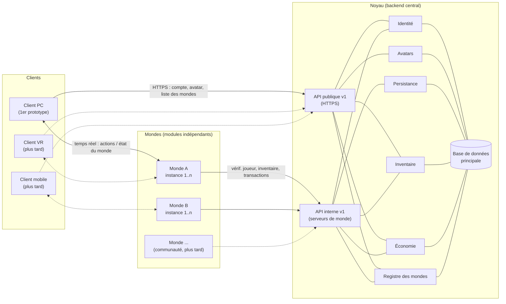

# EUDORIA — Architecture globale

> Statut : **proposition (Phase 0)**. Vue d'ensemble à haut niveau, sans détail d'implémentation.
> Les choix de technologies sont traités dans `docs/decisions/` (ADR) et ne sont pas encore validés.

## 1. Principes directeurs

1. **Noyau séparé des mondes.** Le noyau gère ce qui est commun à tout l'univers ; les mondes gèrent leur propre simulation.
2. **Le serveur fait autorité.** Le client affiche et envoie des *intentions* (« je veux avancer », « je veux acheter »). Le serveur décide. Le client n'est jamais cru sur parole.
3. **Contrats versionnés.** Tout échange entre composants passe par une API versionnée (`v1`, `v2`…). Un monde écrit pour `v1` continue de fonctionner quand `v2` arrive.
4. **Une seule identité.** Un compte = un identifiant stable, un avatar, valable dans tous les mondes.
5. **Isolation.** Un monde qui plante, est mis à jour ou est malveillant ne doit pas compromettre le noyau ni les autres mondes.
6. **Multi-plateforme dès la conception.** La logique de jeu ne dépend jamais du type d'appareil ; seule la couche « entrées / affichage » change entre PC, VR et mobile.
7. **Croissance progressive.** On démarre simple (peu de services, un seul serveur), mais les frontières sont tracées dès maintenant pour pouvoir découper et multiplier plus tard.

## 2. Les trois grands blocs

### 2.1 Le noyau (backend central)
Ensemble de services qui détiennent la **vérité commune** de l'univers :

| Service | Responsabilité |
|---|---|
| **Identité** | Comptes, authentification, émission et vérification des jetons. |
| **Avatars** | Apparence et identité visuelle de chaque habitant. |
| **Persistance** | Données durables des joueurs (état, progression, réputation). |
| **Inventaire** | Objets possédés, transferts entre joueurs et entre mondes. |
| **Économie** | Monnaie commune, transactions, journal d'audit. |
| **Registre des mondes** | Liste des mondes, leurs adresses, leur état, leurs versions d'API, l'orientation des joueurs vers un monde. |
| **Social** (plus tard) | Amis, groupes, messagerie, présence. |

Au début, ces services peuvent vivre **dans un seul programme** découpé en modules bien séparés
(un « monolithe modulaire »). Ils pourront devenir des programmes séparés si la charge l'exige,
sans changer leurs contrats.

Le noyau s'appuie sur une **base de données principale** (voir ADR-0002) et, plus tard, sur un cache
et un système de messages entre services.

### 2.2 Les mondes (serveurs de monde)
- Chaque monde est un **module indépendant** : son code, ses règles, son contenu, son rythme de mises à jour.
- Un monde fait tourner une ou plusieurs **instances** (copies du même monde, pour répartir les joueurs).
- Le serveur de monde **simule** ce qui se passe (positions, collisions, règles du jeu) et en fait autorité.
- Il ne gère **pas** l'identité, la monnaie ni l'inventaire commun : il les **demande au noyau** via l'API interne.
- Il peut avoir ses propres données locales (état d'une partie, carte), à condition qu'elles ne contredisent pas le noyau.

### 2.3 Les clients
- **Client PC** (premier prototype), puis **VR** et **mobile**.
- Un client ne contient **aucune logique qui fait foi** : il affiche, interpole, prédit pour la fluidité, et envoie des intentions.
- Organisation interne prévue pour le multi-plateforme :
  - **cœur partagé** : réseau, protocole, état affiché, interface logique ;
  - **couche plateforme** : entrées (clavier/souris, manettes VR, tactile), caméra, interface adaptée à l'écran.

## 3. Comment les blocs communiquent

| Liaison | Nature | Usage |
|---|---|---|
| Client → Noyau | Requêtes **HTTPS**, API publique versionnée | Connexion, profil, avatar, inventaire, liste des mondes, achats. |
| Client ↔ Monde | **Temps réel** (connexion persistante, voir ADR-0004) | Déplacements, actions, état du monde, discussion locale. |
| Monde → Noyau | API **interne** versionnée, authentifiée par serveur | Vérifier un joueur, lire/écrire l'inventaire, transactions, rapport d'état au registre. |
| Noyau → Monde | Notifications (plus tard, via système de messages) | Ex. : un objet a été donné au joueur depuis un autre monde. |

### Parcours type d'un joueur
1. Le client se connecte au **noyau** (Identité) et reçoit un **jeton**.
2. Il demande au **registre des mondes** où aller ; le registre renvoie l'adresse d'une instance.
3. Le client se connecte au **serveur de monde** en présentant son jeton.
4. Le serveur de monde **vérifie le jeton** auprès du noyau (ou via sa signature) et charge l'avatar.
5. Pendant la session, le monde envoie au noyau tout ce qui doit être persisté ou qui touche l'économie.
6. Pour changer de monde, le client redemande une destination au registre et recommence à l'étape 3.

## 4. Schéma d'ensemble



Les flèches en pointillés représentent ce qui viendra plus tard.

## 5. Sécurité (vue d'ensemble)
- Tout le trafic externe est chiffré.
- Les jetons d'identité sont signés et expirent ; le noyau peut les révoquer.
- Les serveurs de monde ont leur **propre identité** auprès du noyau, avec des droits limités
  (un monde ne peut pas créer de monnaie à volonté ; plus tard, un monde communautaire aura encore moins de droits).
- Les opérations économiques sont atomiques et journalisées.
- Les secrets ne sont jamais dans le code (variables d'environnement).

## 6. Structure du dépôt (proposition, à valider avec les ADR)

Un seul dépôt git (« monorepo ») tant que le projet est porté par une seule personne :

```
eudoria/
├── docs/                # vision, roadmap, architecture, ADR, progrès
├── core/                # le noyau (backend)
├── worlds/              # un dossier par monde (serveur de monde)
├── client/              # le client (projet du moteur de jeu)
├── shared/              # contrats d'API, protocole réseau, code commun
└── tools/               # scripts de dev, environnement local
```

Le détail interne de chaque dossier sera défini à l'étape qui le crée.

## 7. Ce qui n'est pas encore décidé
- Langage et framework du noyau → ADR-0001.
- Base de données → ADR-0002.
- Moteur du client → ADR-0003.
- Solution réseau multijoueur → ADR-0004.
- Hébergement, déploiement, observabilité : à traiter plus tard, avant toute mise en ligne publique.
