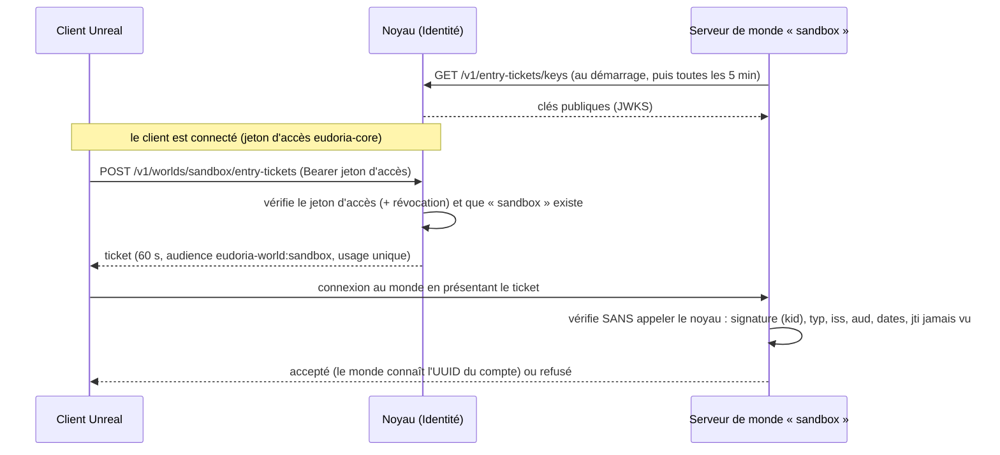

# Étape 1.6 — Vérification de l'identité par un service tiers : le ticket d'entrée des mondes

- **Statut :** ✅ Plan validé par le porteur le 2026-11-26 (6 recommandations du § 13) — réalisation à lancer (aucun code écrit)
- **Date :** 2026-11-25
- **Branche :** `etape-01-identite`
- **Périmètre :** sous-étape 1.6 **uniquement** : le noyau délivre un **ticket d'entrée** propre à un monde, publie
  ses clés publiques, et un **composant tiers simulé** vérifie ce ticket **sans appeler le noyau**. Pas de serveur
  dédié (étape 3), pas de registre des mondes (étape 6), pas de scène (1.7).
- **Critère de la ROADMAP visé :** « Un composant tiers (simulé dans les tests) peut vérifier un jeton et obtenir
  l'identifiant du compte. »

## 1. Vérifications faites avant d'écrire ce plan

- **Jeton d'accès actuel** (`Tokens/AccessTokenIssuer.cs`, `IdentityModule.cs`) : ES256, en-tête `typ: JWT`, audience
  `eudoria-core`. La vérification du noyau accepte `ValidTypes = ["JWT"]` : c'est le type **générique**, que porterait
  aussi n'importe quel autre JWT. Il faut donc **aussi** changer le type du jeton d'accès (§ 5.4), sinon la règle
  « jamais confondus, dans les deux sens » ne tient que par l'audience.
- **`kid` actuel** : 16 premiers caractères de l'empreinte SHA-256 de la clé publique (`TokenSigningKey.cs`). Déjà prévu
  pour la rotation, mais pas au format standard (RFC 7638).
- **Unreal 5.8 fournit OpenSSL 1.1.1t** (`Engine/Source/ThirdParty/OpenSSL/1.1.1t`, Win64, Linux et Android) : de quoi
  vérifier une signature ES256 en C++ **sans nouvelle librairie**. Cette version n'est plus suivie par OpenSSL depuis
  septembre 2023 (risque noté au § 15).
- Le plugin `EudoriaCore` dépend aujourd'hui de `HTTP` et `Json` ; le transport HTTP remplaçable de la 1.5 servira à
  télécharger les clés publiques.
- Aucun registre des mondes, aucun serveur de monde : il faut simuler les deux (§ 7 et § 8).

## 2. Objectif et résultat visible

Un monde doit pouvoir répondre à la question « qui est ce joueur ? » **seul**, sans demander au noyau, et sans jamais
recevoir le jeton d'accès du noyau (décision du porteur du 2026-11-24).

```
# 1. Le client demande un ticket pour un monde précis (avec son jeton d'accès)
POST /v1/worlds/sandbox/entry-tickets      Authorization: Bearer <jeton d'accès>
  → 200 {"ticket":"eyJ…","expiresIn":60}   (Cache-Control: no-store)
  → 401                                     (jeton absent, expiré, révoqué)
  → 404 world_unknown                       (monde inconnu)
  → 429 too_many_requests

# 2. Le monde récupère (à son démarrage, puis toutes les 5 min) les clés publiques du noyau
GET /v1/entry-tickets/keys
  → 200 {"keys":[{"kty":"EC","crv":"P-256","x":"…","y":"…","kid":"…","alg":"ES256","use":"sig"}]}

# 3. Le monde vérifie le ticket hors ligne → identifiant du compte (UUID), ou refus avec une raison précise
```

## 3. Découpage proposé (règle « une tâche à la fois »)

La 1.6 touche deux mondes techniques (noyau .NET et C++ Unreal). Je propose **deux parties**, chacune testée,
commitée et présentée séparément :

| Partie | Contenu | Résultat |
|---|---|---|
| **1.6 A — noyau** | ticket, clés publiques, type explicite des jetons, mondes connus, **vérificateur tiers en .NET** (projet séparé, sans aucun lien avec le code du noyau) | Critère de la ROADMAP rempli |
| **1.6 B — C++** (décision 1, § 13) | vérificateur en **C++** dans `EudoriaCore` (celui que le serveur de monde utilisera à l'étape 3) + demande de ticket par le client Unreal + test de bout en bout | Code prêt à brancher à l'étape 3 |

Je m'arrête après la partie A pour ton contrôle avant d'attaquer la B.

## 4. Le parcours complet



Points importants :
- Le client **ne garde le ticket qu'en mémoire**, le demande **juste avant** de se connecter au monde, et **ne s'en sert
  qu'une fois** ; il n'est jamais écrit dans un journal (ni côté client, ni côté noyau, ni côté monde).
- Le **jeton d'accès ne quitte jamais la liaison client ↔ noyau**. Un monde (même malveillant) ne reçoit qu'un ticket
  valable 60 s, pour lui seul, une seule fois.
- La vérification par le monde est **synchrone** une fois les clés en mémoire : utile à l'étape 3, où la porte d'entrée
  d'un serveur Unreal (`PreLogin`) attend une réponse immédiate.
- **Comment le ticket voyage dans la connexion Unreal** (adresse de connexion, message de la poignée de main…) : choisi à
  l'étape 3. Contrainte posée dès maintenant : **jamais dans l'adresse de connexion** (`?ticket=…`), car Unreal écrit
  cette adresse dans ses journaux.

## 5. Le ticket

### 5.1 Contenu minimal

En-tête : `alg: ES256`, `typ: eudoria-entry+jwt`, `kid: <identifiant de la clé des tickets>`.

| Revendication | Valeur | Pourquoi |
|---|---|---|
| `iss` | `eudoria-core` | qui l'a émis |
| `sub` | UUID du compte | **la seule information utile au monde** (identifiant stable) |
| `aud` | `eudoria-world:<id du monde>` — **une seule valeur**, pas une liste | le monde visé, et lui seul |
| `iat` | date d'émission | refuser un ticket « venu du futur » |
| `exp` | `iat` + **60 s** | durée de vie très courte |
| `jti` | identifiant aléatoire unique (UUID v4, 122 bits aléatoires) | usage unique (§ 5.3) |

**Rien d'autre** : ni pseudo, ni e-mail, ni avatar. Le monde les demandera au noyau par l'API interne quand il aura sa
propre identité (étape 3). Moins le ticket contient, moins une fuite révèle.

### 5.2 Durée de vie : 60 s (décision 4)

Assez pour demander le ticket puis ouvrir la connexion au monde (quelques secondes en pratique, même sur mobile),
trop court pour qu'un ticket volé serve longtemps. Tolérance d'horloge côté monde : **15 s** (les serveurs seront
synchronisés par NTP). Fenêtre d'acceptation maximale : 75 s.

### 5.3 Usage unique : comment empêcher le rejeu

Le monde ne peut pas demander au noyau « ce ticket a-t-il déjà servi ? » (c'est la règle). Donc :
1. **Le monde retient chaque `jti` accepté** jusqu'à `exp` + tolérance, puis l'oublie. Un `jti` déjà vu → refus
   `ticket_replayed`. Comme un ticket vit 75 s au plus, la mémoire reste minuscule (même 1 000 connexions par minute
   = environ 1 250 entrées).
2. Mémoire **bornée** (100 000 entrées). Si elle est pleine : **refus** des nouveaux tickets (on préfère refuser que
   laisser passer un rejeu) et un avertissement dans les journaux.
3. **Limites connues, acceptées pour l'instant :** (a) deux **instances** du même monde ne partagent pas cette mémoire :
   un ticket volé pourrait servir une fois sur chaque instance pendant 75 s ; (b) un serveur qui **redémarre** oublie les
   `jti` vus. Remède prévu à l'étape 6 (§ 9) : ticket lié à une instance précise, ou défi aléatoire du serveur inclus
   dans le ticket.
4. Le **vol** lui-même est rendu difficile en amont : ticket transmis en HTTPS par le noyau, liaison client ↔ monde
   chiffrée (à l'étape 3), ticket jamais dans les journaux.

### 5.4 Ne jamais confondre ticket et jeton d'accès (RFC 8725, § 3.11 et 3.12)

Trois verrous **indépendants** — un seul suffirait à bloquer la confusion, on les met tous :

| Verrou | Jeton d'accès | Ticket d'entrée |
|---|---|---|
| **Type explicite** (`typ`) | `eudoria-access+jwt` (**changement** : aujourd'hui `JWT`) | `eudoria-entry+jwt` |
| **Audience** (`aud`) | `eudoria-core` | `eudoria-world:<id>` |
| **Clé de signature** (décision 2) | clé actuelle | **clé distincte**, la seule publiée |

- Le noyau n'accepte plus **que** `typ: eudoria-access+jwt` : un ticket présenté au noyau est refusé (type, audience
  et clé). Un JWT au type générique `JWT` aussi, y compris les anciens jetons d'accès — sans gravité : le client reçoit
  un 401, renouvelle, et obtient un jeton du nouveau type (mécanisme de la 1.5).
- Le monde n'accepte **que** `typ: eudoria-entry+jwt` et **son** audience : un jeton d'accès qui lui serait donné est
  refusé (type, audience, et de toute façon il ne connaît pas la clé des jetons d'accès).
- Pourquoi pas le type standard `at+jwt` (RFC 9068) pour le jeton d'accès ? Cette norme impose d'autres revendications
  (`client_id`…) que notre jeton n'a pas ; prendre son nom sans la respecter tromperait un outil tiers. Un nom à nous
  est honnête et tout aussi explicite.
- Comparaison du `typ` : exacte (c'est nous qui l'écrivons).

### 5.5 Émission par le noyau

- Route protégée (le jeton d'accès est vérifié, **révocation comprise** : après « tout déconnecter », plus aucun
  ticket). Un ticket déjà délivré reste valable ses 60 s : accepté, comme pour le jeton d'accès (≤ 15 min).
- Débit limité par adresse (nouvelle politique `EntryTicket`, 30 par minute, dans `appsettings.json`).
- Journal : « ticket délivré, compte X, monde Y » au niveau Information ; **jamais le ticket**.
- Module **Identité**, dossier `EntryTickets/`.

## 6. Publication des clés publiques (JWKS) et rotation future

- **Route publique, sans authentification** : `GET /v1/entry-tickets/keys` (une clé publique n'a rien de secret).
  Format standard **JWK Set** (RFC 7517), type `application/jwk-set+json`, `Cache-Control: public, max-age=300`.
  Débit limité par adresse (60 par minute).
- Elle ne contient **que** la partie publique (`kty`, `crv`, `x`, `y`, `kid`, `alg`, `use`) — **jamais `d`** (la partie
  privée) : vérifié par un test. Elle ne contient **pas** la clé des jetons d'accès (décision 2).
- `kid` de la clé des tickets : **empreinte standard RFC 7638** de la clé publique (n'importe qui peut la recalculer et
  vérifier qu'elle correspond). Le `kid` du jeton d'accès reste tel quel (inutile de le toucher).
- **Côté monde (vérificateur) :** télécharge les clés au démarrage, les rafraîchit toutes les 5 min, choisit la clé
  **par `kid`**. `kid` inconnu → **un** nouveau téléchargement (au plus un par minute, pour qu'un faux ticket ne
  provoque pas une avalanche de requêtes), puis refus s'il reste inconnu. Noyau injoignable → le monde garde les
  clés qu'il a (les tickets restent vérifiables) ; au démarrage sans clé → il refuse tout (`keys_unavailable`).
- **Ce que ça prépare pour la rotation** (rien de tout ça n'est fait en 1.6 : une seule clé) — la publication étant
  une **liste** et le choix se faisant par `kid`, changer de clé se fera sans couper personne :
  1. publier la nouvelle clé à côté de l'ancienne (sans signer avec), attendre ≥ 5 min (durée du cache des mondes) ;
  2. signer les nouveaux tickets avec la nouvelle clé ;
  3. retirer l'ancienne après 75 s (durée max. d'un ticket).
  En cas de **clé compromise** : retrait immédiat ; les mondes la gardent au plus 5 min (limite notée au § 15).
  Configuration de plusieurs clés et procédure écrite : avant l'hébergement public (étape 6).

## 7. Identifier un monde sans registre

- **Identifiant de monde = texte opaque**, format `^[a-z0-9](?:[a-z0-9-]{0,62}[a-z0-9])?$` (minuscules, chiffres,
  tirets, 1 à 64 caractères). Il accepte un nom lisible aujourd'hui (`sandbox`) **et** un UUID en minuscules demain : le
  registre de l'étape 6 choisira, sans changer le contrat ni le format du ticket.
- **Liste fermée** dans `appsettings.json` : `Identity:EntryTickets:KnownWorlds = ["sandbox"]`. Un monde absent →
  404 `world_unknown`. Une liste fermée évite qu'on fabrique des tickets pour des audiences inventées, et c'est
  exactement le rôle qu'aura le registre.
- Dans le code, une petite interface `IKnownWorlds` (« ce monde existe-t-il ? ») lue depuis la configuration : à
  l'étape 6, le registre la remplacera ; **rien d'autre** ne bouge. Le serveur de monde connaîtra son propre identifiant
  par sa configuration (étape 3).
- La route vit sous `/v1/worlds/{worldId}/…` : c'est là que le registre exposera les mondes (même ressource).

## 8. Le « service tiers » : simulé maintenant, réutilisé plus tard

### 8.1 Partie A — vérificateur tiers en .NET (le critère de la ROADMAP)

- Nouveau petit projet **`core/tests/Eudoria.ThirdParty.WorldVerifier`** : **aucune référence** au code du noyau (le
  compilateur le garantit), seulement `HttpClient`, `System.Security.Cryptography` et `System.Text.Json` du .NET de base.
  Il fait **exactement ce que fera un serveur de monde** : télécharge les clés, vérifie un ticket, retient les `jti`.
  Il **n'utilise pas** la librairie JWT de Microsoft du noyau : on prouve que le format suffit, sans partager d'outil.
- Il est écrit simplement, comme **référence lisible** pour la version C++ (mêmes étapes, mêmes codes de refus).
- Testé de bout en bout contre le noyau en mémoire (Testcontainers, comme aujourd'hui) : inscription → connexion →
  ticket → vérification par le tiers → **même UUID que `GET /v1/me`**.

### 8.2 Partie B — vérificateur en C++ dans `EudoriaCore` (décision 1)

Dans `unreal/Plugins/EudoriaCore/Source/EudoriaCore/Private/EntryTickets/` :

| Morceau | Rôle | Réutilisé à l'étape 3 |
|---|---|---|
| `EudoriaJwt` | découpe du ticket, base64url, lecture stricte de l'en-tête et des revendications (JSON) | oui |
| `EudoriaEs256` | vérification ES256 avec l'OpenSSL du moteur (conversion de la signature JWS `r‖s` en format OpenSSL ; clé construite depuis `x`, `y`) | oui |
| `EudoriaEntryTicketVerifier` | les règles (typ, alg, iss, aud, dates, kid, jti) ; fonction **pure** : reçoit l'heure, les clés, le monde attendu | oui, tel quel, dans `PreLogin` |
| `EudoriaReplayCache` | mémoire des `jti` vus, bornée, oubli après expiration | oui |
| `EudoriaJwksClient` | téléchargement et cache des clés via le transport HTTP de la 1.5 | oui |
| `UEudoriaSession::RequestEntryTicket(WorldId)` | côté **client** : demande le ticket (avec le renouvellement unique de la 1.5 si 401) | oui, avant de rejoindre un monde |

- Le code de **vérification** n'est compilé que là où il y a du code serveur (`WITH_SERVER_CODE` : éditeur et serveur
  dédié), pas dans le client livré.
- Test de bout en bout Unreal (noyau lancé) : le client Unreal se connecte, demande un ticket pour `sandbox`, le
  vérificateur C++ télécharge les clés et l'accepte → UUID identique à `/me` ; rejeu refusé ; vérifié pour un autre
  monde → refusé.
- **Jeux d'essai partagés** `shared/test-vectors/entry-tickets/` : tickets déjà signés (valide, expiré, mauvais `typ`,
  mauvaise audience, signature altérée, `alg: none`, `kid` inconnu…) + **clé publique seulement** (aucune clé privée
  dans le dépôt), produits par un petit script. Les **deux** vérificateurs (.NET et C++) doivent donner exactement le
  même verdict sur chacun : c'est la preuve d'interopérabilité.

### 8.3 Ce qui restera à faire à l'étape 3

Brancher `EudoriaEntryTicketVerifier` dans la porte d'entrée du serveur dédié, choisir le transport du ticket dans la
connexion Unreal (§ 4), refuser un client sans ticket valide (critère de l'étape 3).

## 9. Ce qui est volontairement reporté

| Sujet | Pourquoi plus tard | Étape |
|---|---|---|
| **Identité des serveurs de monde auprès du noyau** (API interne authentifiée par serveur, droits limités) | aucun serveur n'appelle encore le noyau ; le ticket va du noyau au monde **via le client**, sans que le monde s'authentifie | **3** (premier serveur dédié, qui chargera l'avatar depuis le noyau) |
| Transport du ticket dans la connexion Unreal | dépend du serveur dédié | **3** |
| Registre des mondes (remplace la liste de `appsettings.json`), instances | prévu par la ROADMAP | **6** |
| **Anti-rejeu entre instances** d'un même monde (ticket lié à une instance, ou défi du serveur) | une seule instance avant l'étape 6 | **6** |
| Rotation des clés : plusieurs clés configurées, procédure écrite et testée | une seule clé en local | **6** (avant hébergement public) |
| Mémoire anti-rejeu partagée / survivant au redémarrage | une seule instance, locale | **6** |
| **Mondes communautaires** (serveurs non fiables) : identifiant **différent par monde** pour un même compte (empêche de suivre un joueur d'un monde à l'autre), consentement avant d'entrer, droits limités | aucun monde tiers avant le kit de création | **10** |
| Données du joueur pour le monde (pseudo, avatar) | demandées par l'API interne, pas dans le ticket | **2** (avatar) / **3** |
| Mise à jour d'OpenSSL côté Unreal | suit les versions du moteur | à chaque montée de version d'Unreal |

## 10. Contrat de l'API (`shared/api/core-v1.yaml`, 1.3.1 → **1.4.0**)

- `POST /v1/worlds/{worldId}/entry-tickets` (protégée, sans corps) → 200 `{ticket, expiresIn}` / 400 (identifiant mal
  formé) / 401 / 404 `world_unknown` / 429.
- `GET /v1/entry-tickets/keys` (publique) → 200 JWK Set.
- Description du format du ticket (en-tête, revendications, règles de vérification) dans le contrat : c'est ce qu'un
  tiers lit pour l'implémenter.
- Le changement de `typ` du jeton d'accès ne change pas le contrat (le jeton y est opaque) ; noté dans la description.
- Version **mineure** : ajouts compatibles.

## 11. Fichiers créés / modifiés (prévision)

**Partie A**
- `docs/decisions/0007-ticket-entree-mondes.md` — **nouvel ADR** (« Proposé ») : c'est une décision d'architecture
  (comment un monde authentifie un joueur) ; il remplace le « signature **ou** appel au noyau » de `ARCHITECTURE.md` § 3
  par « signature seulement » (décision 5).
- `shared/api/core-v1.yaml` (1.4.0).
- `core/src/Eudoria.Core.Identity/Tokens/` : `TokenType` (les deux `typ`), émission et vérification du jeton d'accès en
  `eudoria-access+jwt`.
- `core/src/Eudoria.Core.Identity/EntryTickets/` : options, clé des tickets (+ `kid` RFC 7638), émission, route,
  `IKnownWorlds`, JWKS.
- `core/src/Eudoria.Core.Api/appsettings.json` : section `Identity:EntryTickets` (durée, mondes connus, débits).
- `tools/dev/new-signing-key.ps1` : paramètre pour générer la clé des tickets dans `.env`
  (`Identity__EntryTickets__SigningKey`) ; `run-core.ps1` / `DotEnv.ps1` la transmettent ; `.env.example`.
- `core/tests/Eudoria.ThirdParty.WorldVerifier/` (nouveau) + ses tests ; tests du noyau.
- `tools/dev/new-entry-ticket-vectors.ps1` + `shared/test-vectors/entry-tickets/`.
- `docs/ARCHITECTURE.md`, `docs/PROGRESS.md`, `docs/ROADMAP.md` (critère coché).

**Partie B**
- `unreal/Plugins/EudoriaCore/Source/EudoriaCore/EudoriaCore.Build.cs` (+ OpenSSL du moteur).
- `…/Private/EntryTickets/*` (tableau du § 8.2), `EudoriaSession` (demande de ticket), tests `Eudoria.EntryTickets.*`.
- `docs/ARCHITECTURE.md` § 9, `docs/PROGRESS.md`.

## 12. Tests

**Noyau (partie A)**
- Émission : 200 ; en-tête exactement `{alg: ES256, typ: eudoria-entry+jwt, kid}` ; revendications **exactement**
  `{iss, sub, aud, iat, exp, jti}` ; `exp − iat = 60` ; `jti` différent à chaque ticket ; `Cache-Control: no-store`.
- Refus : sans jeton → 401 ; jeton expiré, falsifié, ou après « tout déconnecter » → 401 ; monde inconnu → 404 ;
  identifiant mal formé (majuscules, `../`, 65 caractères) → 400 ; débit dépassé → 429.
- Séparation : ticket présenté comme `Bearer` à `/v1/me` → 401 ; ancien jeton d'accès `typ: JWT` (bien signé) → 401 ;
  jeton `eudoria-access+jwt` → 200.
- Clés : route sans authentification → 200 ; pas de `d` ; `kid` = celui des tickets = empreinte RFC 7638 recalculée ;
  la clé des jetons d'accès **n'y est pas** ; en-têtes de cache.
- Journaux : ni ticket ni jeton (test des journaux existant, étendu).
- Contrat : les nouvelles routes respectent `core-v1.yaml` (tests de contrat existants).

**Tiers .NET (partie A)** — même liste de cas que le C++ : valide → UUID = `/me` ; autre monde ; expiré (horloge
manuelle) ; venu du futur ; rejoué ; jeton d'accès présenté comme ticket ; signature altérée ; `alg: none` / `HS256` ;
`typ` absent ou autre ; `aud` en liste ; `kid` inconnu → un seul re-téléchargement puis refus ; noyau injoignable avec
clés en cache → vérifie toujours ; mémoire anti-rejeu pleine → refus.

**Unreal (partie B)** — les jeux d'essai partagés (même verdict qu'en .NET) ; anti-rejeu et oubli après expiration ;
limitation des re-téléchargements ; demande de ticket avec 401 → renouvellement unique → nouvel essai ; bout en bout
contre le noyau lancé ; ticket absent des journaux.

**Tests de mutation** (preuve que les tests mordent) : retirer le contrôle du `typ` côté noyau ; côté tiers, retirer
le contrôle du `typ`, de l'audience, puis de la mémoire des `jti` ; ajouter `d` à la publication ; inverser `r` et `s`
dans la conversion de signature C++. Chacun doit faire échouer au moins un test.

**Lancement réel** : noyau lancé avec `run-core.ps1`, parcours par `curl` (connexion → ticket → clés), journal relu.

## 13. Points qui demandent ton accord

1. **Découpage et partie B.**
   - **A (recommandé)** : 1.6 A puis 1.6 B dans cette sous-étape (contrôle entre les deux). Le vérificateur C++ est le
     code exact du serveur de l'étape 3, déjà lourde (moteur compilé depuis les sources, serveur dédié) ; et un
     vérificateur dans un **autre langage** attrape tôt les erreurs d'interopérabilité (format de signature, base64url).
   - B : 1.6 A seulement ; le C++ part à l'étape 3. Plus court, le critère de la ROADMAP est quand même rempli.
2. **Clé de signature des tickets distincte de celle des jetons d'accès.**
   - **A (recommandé)** : clé distincte. Troisième verrou contre la confusion, et les mondes ne peuvent **même pas**
     vérifier un jeton d'accès. Coût : un secret de plus dans `.env` (même script, même règle).
   - B : même clé (plus simple ; la séparation repose sur `typ` + audience).
3. **Changer le `typ` du jeton d'accès** en `eudoria-access+jwt`, et n'accepter plus que lui au noyau — recommandé :
   oui (sinon la séparation ne vaut que dans un sens). Effet : les sessions ouvertes renouvellent une fois.
4. **Durées** : ticket **60 s**, tolérance d'horloge du monde **15 s** — recommandé : oui.
5. **ADR-0007** « Ticket d'entrée des mondes » rédigé au premier commit (« Proposé »), à valider par toi avec la
   partie A — recommandé : oui (règle 3 de `CLAUDE.md` : c'est un choix d'architecture).
6. **Identifiant du premier monde** : `sandbox` — à toi de le renommer si tu veux (format du § 7).

**Décisions du porteur (2026-11-26) :** 1 = A (partie A puis partie B, contrôle entre les deux), 2 = A (clé des tickets
distincte), 3 = oui (`typ: eudoria-access+jwt` exigé par le noyau), 4 = oui (ticket 60 s, tolérance 15 s), 5 = oui
(ADR-0007 au premier commit, « Proposé »), 6 = `sandbox`.

## 14. Qui fait quoi

- **Toi** : le « OK » sur ce plan et les 6 points ; relecture de l'ADR-0007 ; contrôle après la partie A, puis après la B.
  Rien à installer, rien à lancer à la main.
- **Moi** : tout le reste, y compris la génération de la clé des tickets dans ton `.env` (jamais affichée), les tests,
  le lancement réel, la documentation, les commits et l'envoi sur GitHub.

## 15. Risques

| Risque | Parade |
|---|---|
| Rejeu d'un ticket volé sur une autre instance, ou après un redémarrage du monde | 60 s, une seule audience, ticket jamais journalisé ; vrai remède à l'étape 6 (§ 9) |
| Clé compromise gardée en cache par les mondes jusqu'à 5 min | accepté en local ; à traiter avec la procédure de rotation (étape 6) |
| OpenSSL 1.1.1t (plus suivi) côté Unreal | on ne fait que **vérifier** des signatures avec des clés publiques (pas de TLS maison) ; surveillé à chaque version d'Unreal ; repli possible sur un autre module de chiffrement du moteur si besoin (à étudier, avec ton accord) |
| Erreur subtile de format ES256 (signature JWS `r‖s` 64 octets ≠ format DER d'OpenSSL) | jeux d'essai partagés + test de mutation dédié |
| Changement de `typ` du jeton d'accès qui casse le client | le client traite déjà le 401 par un renouvellement (1.5) ; test d'intégration Unreal relancé |
| Horloges décalées entre noyau et monde | tolérance 15 s ; NTP sur les serveurs (hébergement) |
| Compilations Unreal avec 16 Go | inchangé : `MaxParallelActions` = 6 ; partie B = quelques fichiers seulement |

## 16. Dépendances

- **Aucune nouvelle librairie .NET** : `System.Security.Cryptography` et `System.Text.Json` (fournis par .NET) pour le
  tiers ; la librairie JWT de Microsoft, déjà présente, pour le noyau.
- **Unreal : module OpenSSL fourni par le moteur** (`AddEngineThirdPartyPrivateStaticDependencies(Target, "OpenSSL")`) —
  rien à télécharger, licence déjà acceptée avec le moteur.

## 17. Commits prévus (petits)

**Partie A**
1. `docs(adr): propose ADR-0007 world entry tickets` (+ ce plan validé)
2. `feat(api): add entry tickets and ticket keys to core-v1 1.4.0`
3. `refactor(identity): type access tokens as eudoria-access+jwt and require it`
4. `chore(tools): generate the entry ticket signing key`
5. `feat(identity): issue world entry tickets`
6. `feat(identity): publish entry ticket keys as a JWK Set`
7. `test(core): add an independent third-party ticket verifier`
8. `test(shared): add entry ticket test vectors`
9. `docs(architecture): describe entry tickets; update progress`

**Partie B**
10. `feat(unreal): add JWT parsing and ES256 verification on engine OpenSSL`
11. `feat(unreal): add the entry ticket verifier, replay cache and key client`
12. `feat(unreal): let the client request an entry ticket`
13. `test(unreal): verify an entry ticket end to end against the core`
14. `docs(architecture): describe the Unreal ticket verifier; update progress`
